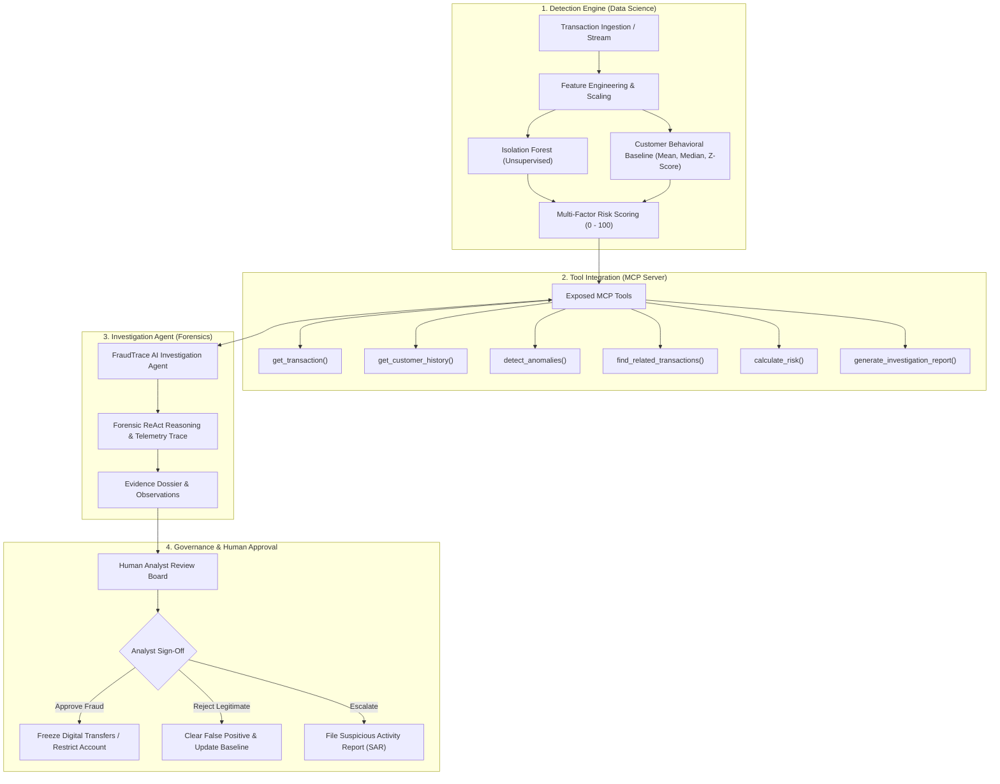

# FraudTrace 🛡️
### Intelligent Financial Transaction Monitoring, Anomaly Detection & AI Investigation Platform

> **Moving from simply detecting suspicious transactions to helping analysts investigate, explain, and understand them.**

FraudTrace combines **Machine Learning (Isolation Forest & Behavioral Profiling)** for unsupervised anomaly detection, an **Autonomous AI Investigation Agent** for forensic reasoning, and the **Model Context Protocol (MCP)** for standardized tool discovery and execution.

---

## 🌟 The Core Philosophy

| Traditional Fraud Systems | The FraudTrace Paradigm |
| :--- | :--- |
| **Opaque Alert**: "Suspicious Transaction TXN-12345. Risk Score: 94." | **Explainable Forensic Report**: Explains *why* the transaction was flagged, baseline deviations, velocity bursts, and recommended analyst actions. |
| **Rigid Predefined Rules**: Flag amounts > ₹50,000 or after 10 PM. Misses complex multi-dimensional patterns. | **Unsupervised Anomaly Detection**: Isolation Forest identifies rare feature split combinations without needing labeled fraud samples. |
| **Manual Investigation Burden**: Analysts spend hours querying disparate databases, customer history, and velocity logs. | **Autonomous AI Agent via MCP**: Agent dynamically calls specialized tools (`get_customer_history`, `detect_anomalies`, `find_related_transactions`) to assemble an evidence dossier. |
| **Inconsistent Recordkeeping**: Decisions and notes are scattered or undocumented. | **Human-in-the-Loop Governance**: Strict audit trail where human compliance officers review findings, record notes, and sign off on SAR filings. |

---

## 🏗️ System Architecture & Workflow



---

## 🚀 Key Features

### 1. Transaction Intelligence Dashboard
- Real-time KPIs: Gross Processed Volume, Anomaly Detection Rate, At-Risk Volume Exposure.
- **24-Hour Transaction Flow vs Anomaly Timeline**: Interactive area chart showing transaction spikes and off-hour nocturnal anomalies.
- **Threat Tier Distribution**: Calibrated into *Critical*, *High*, *Medium*, and *Low*.
- **Prioritized High-Risk Feed**: Direct 1-click jump to inspect or trigger autonomous AI investigation.

### 2. Fraud Detection Engine (Data Science)
- **Isolation Forest (Unsupervised)**: Operates without synthetic labels; isolates unusual observations based on feature distance.
- **Customer Behavioral Profiler**: Evaluates individual customer spend ceilings, channel preferences (Mobile/Web/POS/ATM), home city, and nocturnal transaction ratio.
- **Explainable Anomaly Splits**: Generates human-readable explanations (e.g., *"17.2x typical spend ceiling"*, *"High-value digital channel switch"*, *"Off-hours execution"*).

### 3. Model Context Protocol (MCP) Server
Standardized Python MCP SDK 2.x implementation exposing 6 dedicated tools:
1. `get_transaction(transaction_id)`: Retrieve transaction metadata, execution channel, and risk tier.
2. `get_customer_history(user_id)`: Historical spend distributions, mean/median, standard deviation, and profile limits.
3. `detect_anomalies(transaction_id)`: Isolation score, percentile ranking, and feature splits.
4. `find_related_transactions(transaction_id, window_hours)`: Rapid velocity bursts, repeated merchant clusters, and cross-city hops.
5. `calculate_risk(transaction_id)`: Multi-factor explainable composite score synthesis.
6. `generate_investigation_report(transaction_id)`: Structured SAR-ready report generation.

### 4. Autonomous AI Investigation Agent & Live Telemetry
- Runs a multi-step investigation loop logging every thought, tool invocation, input payload, and result to `agent_logs`.
- Interactive Analyst Chat Console: Compliance officers can ask questions in natural language:
  - *"Why was this transaction flagged?"*
  - *"Did this customer ever make purchases in Kolkata before?"*
  - *"Check velocity over the last 48 hours."*
- Supports Google Gemini API, Anthropic Claude, OpenAI, and includes an offline built-in forensic engine.

### 5. Human Approval System & SAR Dossier Generation
- Regulatory compliance interface with human-in-the-loop sign-off:
  - **Approve Fraud**: Confirms unauthorized takeover; freezes cards and digital transfer privileges.
  - **Mark Legitimate**: Marks false positive after phone/SMS OTP verification; whitelists customer.
  - **Escalate to Legal**: Initiates formal FIU Suspicious Activity Report (SAR).
- Printable and downloadable formal SAR compliance dossiers with official audit stamps.

---

## 🛠️ Technology Stack

| Layer | Technology | Purpose |
| :--- | :--- | :--- |
| **Frontend** | React 19, Vite, Tailwind CSS v4 | Dark fintech UI with navy palette and glassmorphism |
| **Data Visualizations** | Recharts, Lucide Icons | Scatter clusters, hourly velocity area graphs, risk donuts |
| **Backend API** | FastAPI, Uvicorn | High-performance asynchronous REST API |
| **Data Science & ML**| Scikit-learn, Pandas, NumPy | Isolation Forest, behavioral aggregations, percentile calibration |
| **Agent & Tools** | Python MCP SDK 2.x | Model Context Protocol standardized server and tool dispatch |
| **Database & ORM** | SQLite / PostgreSQL, SQLAlchemy | Transactions, customers, investigations, agent logs, approvals |
| **Validation** | Pydantic v2 | Strict schema typing and request validation |

---

## ⚡ Quick Start

### 1. Prerequisites
- Python 3.10+
- Node.js 18+ and npm

### 2. Backend Setup
```bash
# Activate virtual environment
# Windows:
.venv\Scripts\activate
# Linux/macOS:
source .venv/bin/activate

# Install dependencies
pip install -r requirements.txt

# Seed realistic synthetic dataset (2,000 transactions, 120 customer profiles)
python -m backend.app.services.data_generator

# Start FastAPI server
python -m uvicorn backend.app.main:app --reload --port 8000
```

### 3. Frontend Setup
```bash
cd frontend
npm install
npm run dev
```
Open **`http://localhost:5173`** in your browser. (The backend also serves the production build at `http://localhost:8000/`).

---

## 📋 MCP Standalone Server
To run FraudTrace as a dedicated MCP Server (compatible with Claude Desktop, Cursor, or Gemini Agents):
```bash
python -m backend.app.mcp.server
```

---

## 🔒 Security & Compliance Notice
Risk scores generated by FraudTrace reflect relative statistical anomaly distance and behavioral deviation heuristics. In accordance with AML best practices, automated decisions enforce a strict human-in-the-loop review workflow prior to permanent account closure or SAR submission.
